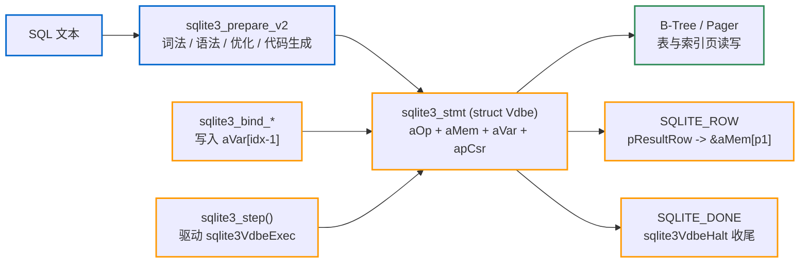
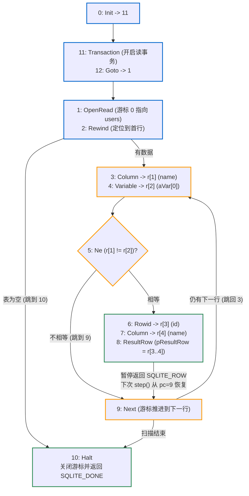
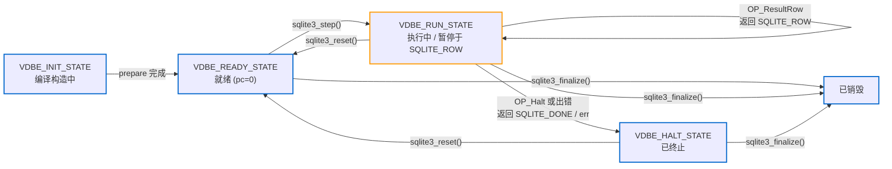

# SQLite 语句执行引擎 VDBE 内部机制解析

**日期**: 2026-11-27

在为 `stdgo.database.sql` 实现和排查 SQLite 驱动（[src/database/sql/sqlite.zig](../src/database/sql/sqlite.zig)）时，很多看似“C API 规定如此”的约束——比如 `SQLITE_STATIC` 与 `SQLITE_TRANSIENT` 的生命周期差异、`INSERT ... RETURNING` 必须消费到 `SQLITE_DONE`、`Rows.next()` 返回的字符串只能借用到下一次 `next()`——背后都指向同一个核心组件：**VDBE（Virtual Database Engine，虚拟数据库引擎）**。

本文基于本仓库使用的 [SQLite 3.53.0](https://github.com/sqlite/sqlite/tree/version-3.53.0) 源码，梳理 `sqlite3_stmt` 与 VDBE 的数据结构、状态机和字节码执行流程，并把这些内部机制与驱动层的实际工程问题一一对应起来。

---

## 1. `sqlite3_stmt` 本质上是一台字节码虚拟机

SQLite C API 对外暴露的是不透明指针 [`sqlite3_stmt*`](https://github.com/sqlite/sqlite/blob/version-3.53.0/src/sqlite.h.in#L4303)，它在公开头文件中只是一个未定义结构体的前置声明（`typedef struct sqlite3_stmt sqlite3_stmt;`），用来隐藏内部符号名；而在 SQLite 内部，实际分配的是 [`struct Vdbe`](https://github.com/sqlite/sqlite/blob/version-3.53.0/src/vdbeInt.h#L458)，各 C API 入口再通过显式指针强转（如 [`sqlite3_step`](https://github.com/sqlite/sqlite/blob/version-3.53.0/src/vdbeapi.c#L915) 中的 `Vdbe *v = (Vdbe*)pStmt;`）转回使用。

> [!NOTE]
> **这种写法完全符合 C 语言规范（C11）**：
> - `typedef struct sqlite3_stmt sqlite3_stmt;` 声明的是合法的不完整类型（incomplete type），外部代码只能传递或比较指针，无法 `sizeof`、按值创建或解引用；
> - [C11 §6.2.5p28](https://port70.net/~nsz/c/c11/n1570.html#6.2.5p28) 规定**所有结构体指针具有相同的内存表示和对齐要求**，因此 `Vdbe*` → `sqlite3_stmt*` → `Vdbe*` 的往返强转保证无损（[C11 §6.3.2.3p7](https://port70.net/~nsz/c/c11/n1570.html#6.3.2.3p7)）；
> - 因为没有任何代码会通过 `sqlite3_stmt*` 解引用读写内存，所有实际访问都经由真实有效类型 `Vdbe*` 完成，不违反 Strict Aliasing（[C11 §6.5p7](https://port70.net/~nsz/c/c11/n1570.html#6.5p7)）。在 Zig 中，`translate-c` 也会把此类未定义结构体直接映射为 `opaque {}`。

SQLite 并不在运行时直接解释 SQL 语法树，而是把执行过程分成前端编译和后端执行两段：

1. **前端编译（[`sqlite3_prepare_v2`](https://github.com/sqlite/sqlite/blob/version-3.53.0/src/prepare.c#L937)）**：词法分析 → 语法解析 → 查询优化 → 代码生成，最终把一条 SQL 编译成一段线性字节码指令序列，由 `Vdbe.aOp`（`Op *`）指向。
2. **后端执行（[`sqlite3_step`](https://github.com/sqlite/sqlite/blob/version-3.53.0/src/vdbeapi.c#L913)）**：驱动 [`sqlite3VdbeExec()`](https://github.com/sqlite/sqlite/blob/version-3.53.0/src/vdbe.c#L846) 主循环，按程序计数器 `pc` 逐条解释执行字节码，读写寄存器、操作 B-Tree 游标并产出结果行。



可以把每个 `sqlite3_stmt` 理解成一个独立的、可暂停的寄存器虚拟机实例：同一条连接（`sqlite3*`）上可以同时挂多个 `Vdbe`（内部通过 `Vdbe.ppVPrev` / `pVNext` 串成链表），各自拥有独立的指令、寄存器和游标状态。

---

## 2. `Vdbe` 的核心数据结构

打开 [`src/vdbeInt.h`](https://github.com/sqlite/sqlite/blob/version-3.53.0/src/vdbeInt.h#L458) 中的 `struct Vdbe`，与执行最直接相关的字段可以归为五类（`aOp`、`aMem`、`aVar`、`apCsr` 在结构体中均为堆指针，而非定长 C 数组）：

### 2.1 指令序列：[`Op *aOp`](https://github.com/sqlite/sqlite/blob/version-3.53.0/src/vdbeInt.h#L482)

VDBE 是一台**基于寄存器**的虚拟机（早年是栈式，后来改为寄存器式以减少栈操作指令）。每条指令（[`struct VdbeOp`](https://github.com/sqlite/sqlite/blob/version-3.53.0/src/vdbe.h#L55)）由 1 个操作码和最多 5 个操作数构成：

```c
typedef struct VdbeOp Op;

struct VdbeOp {
  u8 opcode;          /* 操作码，如 OP_OpenRead, OP_Column, OP_ResultRow */
  signed char p4type; /* p4 联合体的类型标签（P4_INT32, P4_COLLSEQ, P4_KEYINFO 等） */
  u16 p5;             /* 16 位附加标志位 */
  int p1;             /* 第 1 操作数（常用于游标编号或参数索引） */
  int p2;             /* 第 2 操作数（常用于跳转目标地址或目标寄存器号） */
  int p3;             /* 第 3 操作数（常用于列号、寄存器号或长度） */
  union p4union {     /* 第 4 操作数（指针、字符串、比较器、表/索引元数据等） */
    /* ... */
  } p4;
  /* 其余 #ifdef 条件编译字段（zComment / iSrcLine / nExec / nCycle）省略 */
};
```

`Vdbe.aOp` 是一个动态分配的 `Op *` 指针（配合 `nOp` 记录有效指令数、`nOpAlloc` 记录已分配容量），指令按地址顺序连续存放在 `aOp[0..nOp-1]` 中，由 `Vdbe.pc` 指向当前正在执行的指令下标。

### 2.2 寄存器缓冲：[`Mem *aMem`](https://github.com/sqlite/sqlite/blob/version-3.53.0/src/vdbeInt.h#L474)

VDBE 没有固定数量的硬件寄存器，而是在编译收尾阶段（[`sqlite3VdbeMakeReady()`](https://github.com/sqlite/sqlite/blob/version-3.53.0/src/vdbeaux.c#L2647)）根据本条 SQL 需要的寄存器总数 `nMem`，连同 `aVar`、`apCsr` 一起打包分配在连续堆内存中（甚至会优先复用 `aOp` 末尾未用完的空闲空间），再把 `Mem *aMem` 指向对应起点。指令中的寄存器编号从 `1` 开始（`aMem[1]`、`aMem[2]`...）。

[`struct sqlite3_value`](https://github.com/sqlite/sqlite/blob/version-3.53.0/src/vdbeInt.h#L232) 是 SQLite 的动态类型值容器：

```c
typedef struct sqlite3_value Mem;

struct sqlite3_value {
  union MemValue {
    double r;           /* MEM_Real */
    i64 i;              /* MEM_Int */
    int nZero;          /* MEM_Zero + MEM_Blob */
    const char *zPType; /* sqlite3_bind_pointer 指针类型 */
    FuncDef *pDef;      /* 聚合函数上下文 */
  } u;
  char *z;              /* 字符串或 BLOB 数据指针 */
  int n;                /* 字节长度（不含结尾 '\0'） */
  u16 flags;            /* 类型标志 + 内存所有权标志 */
  u8  enc;              /* UTF-8 / UTF-16LE / UTF-16BE */
  u8  eSubtype;
  /* --- 以上为浅拷贝区域：#define MEMCELLSIZE offsetof(Mem,db) --- */
  sqlite3 *db;
  int szMalloc;         /* zMalloc 容量 */
  u32 uTemp;            /* OP_MakeRecord 临时存储 serial_type */
  char *zMalloc;        /* SQLite 内部持有的堆缓冲区 */
  void (*xDel)(void*);  /* 自定义析构函数（MEM_Dyn 时有效） */
  /* #ifdef SQLITE_DEBUG 调试字段（pScopyFrom / mScopyFlags / bScopy）省略 */
};
```

`flags`（[`src/vdbeInt.h#L310`](https://github.com/sqlite/sqlite/blob/version-3.53.0/src/vdbeInt.h#L310)）同时编码了两类信息：
- **值类型**：`MEM_Null`、`MEM_Int`、`MEM_Real`、`MEM_Str`、`MEM_Blob`、`MEM_Zero`。
- **内存所有权**（针对 `z` 指针）：
  - `MEM_Static`：`z` 指向外部只读或调用方管理的内存，VDBE 释放该寄存器时**不会 free `z`**。
  - `MEM_Dyn`：`z` 由 `zMalloc` 或析构函数 `xDel` 管理，释放时会回收内存。
  - `MEM_Ephem`：临时借用内存（例如直接指向 B-Tree 页面缓存中的某段字节），只保证当前指令或当前行有效，跨步进前若需持久化会先深拷贝。

### 2.3 绑定参数槽：[`Mem *aVar`](https://github.com/sqlite/sqlite/blob/version-3.53.0/src/vdbeInt.h#L477)

SQL 中的 `?`、`?1`、`:name`、`@name`、`$name` 占位符，在 `Vdbe` 中由 `Mem *aVar` 指向一块长度为 `nVar` 的连续 `Mem` 区域：
- [`sqlite3_bind_*()`](https://github.com/sqlite/sqlite/blob/version-3.53.0/src/vdbeapi.c#L1834) 直接把值写入 `aVar[idx - 1]`；
- [`sqlite3_clear_bindings()`](https://github.com/sqlite/sqlite/blob/version-3.53.0/src/vdbeapi.c#L149) 遍历 `aVar[0..nVar-1]`，释放动态内存并全部置回 `MEM_Null`。

### 2.4 游标指针表：[`VdbeCursor **apCsr`](https://github.com/sqlite/sqlite/blob/version-3.53.0/src/vdbeInt.h#L476)

`Vdbe.apCsr` 是指向 `nCursor` 个 [`struct VdbeCursor`](https://github.com/sqlite/sqlite/blob/version-3.53.0/src/vdbeInt.h#L79) 指针槽位的二级指针，每张被访问的表、索引、临时表或排序器对应其中一个槽位。游标封装了底层的 B-Tree 游标（`BtCursor`）和当前行解码缓存，负责按主键/索引定位、顺序扫描（[`OP_Rewind`](https://github.com/sqlite/sqlite/blob/version-3.53.0/src/vdbe.c#L6372) / [`OP_Next`](https://github.com/sqlite/sqlite/blob/version-3.53.0/src/vdbe.c#L6510)）以及读取列值（[`OP_Column`](https://github.com/sqlite/sqlite/blob/version-3.53.0/src/vdbe.c#L2975)）。

### 2.5 执行现场与输出行

- [`pc`](https://github.com/sqlite/sqlite/blob/version-3.53.0/src/vdbeInt.h#L466)：程序计数器，记录下次 `sqlite3_step()` 从哪条指令恢复。
- [`eVdbeState`](https://github.com/sqlite/sqlite/blob/version-3.53.0/src/vdbeInt.h#L502)：虚拟机状态（`INIT` / `READY` / `RUN` / `HALT`）。
- [`pResultRow`](https://github.com/sqlite/sqlite/blob/version-3.53.0/src/vdbeInt.h#L486)：指向 `aMem[]` 中连续的 `nResColumn` 个寄存器，也就是 `sqlite3_column_*()` 读取的数据来源。
- [`nChange`](https://github.com/sqlite/sqlite/blob/version-3.53.0/src/vdbeInt.h#L468)：本条语句累计修改的行数，在 VDBE 终止时刷回 `db->nChange`（即 [`sqlite3_changes()`](https://github.com/sqlite/sqlite/blob/version-3.53.0/src/main.c#L1150) 的返回值）。

---

## 3. 一条 `SELECT` 的字节码走读

以如下查询为例（假设 `users` 表结构为 `(id INTEGER PRIMARY KEY, name TEXT)`，且 `name` 上无索引）：

```sql
SELECT id, name FROM users WHERE name = ?;
```

执行 `EXPLAIN SELECT id, name FROM users WHERE name = ?;` 会得到类似下面的字节码（省略部分次要细节）：

```text
addr  opcode         p1  p2  p3  p4      comment
----  -------------  --  --  --  ------  -------------------------------
0     Init           0   11  0           跳转到 11 启动事务与初始化
1     OpenRead       0   2   0   2       打开 users 表（rootpage=2）到游标 0
2     Rewind         0   10  0           游标 0 定位到第一行；表空则跳到 10
3       Column       0   1   1           读取游标 0 的第 1 列 (name) 到 r[1]
4       Variable     1   2   0           把绑定参数 aVar[0] 浅拷贝到 r[2]
5       Ne           2   9   1   BINARY  若 r[1] != r[2]，跳到 9（下一行）
6       Rowid        0   3   0           读取主键 id 到 r[3]
7       Column       0   1   4           读取 name 到 r[4]
8       ResultRow    3   2   0           输出 r[3..4] 共 2 列，暂停返回 SQLITE_ROW
9     Next           0   3   0           游标 0 移到下一行，若有则跳回 3
10    Halt           0   0   0           结束执行，返回 SQLITE_DONE
11    Transaction    0   0   ...         开启读事务
12    Goto           0   1   0           跳回 1 开始主循环
```

对应的字节码执行流与暂停/恢复路径如下：



整个执行过程一目了然：
1. `sqlite3_prepare_v2` 生成上述 13 条指令，设置 `eVdbeState = VDBE_READY_STATE`，此时尚未触碰任何数据页。
2. `sqlite3_bind_text64` 把参数写入 `aVar[0]`。
3. 第一次调用 `sqlite3_step()`：虚拟机从 `addr=0` 跳到 `11` 开启读事务，回到 `1` 打开游标并扫描表；当匹配到第一条满足 `name = ?` 的记录时，执行 `addr=8` 的 `OP_ResultRow`，将 `pResultRow = &aMem[3]`、`pc = 9`，然后**直接返回 `SQLITE_ROW`**。
4. 调用方通过 `sqlite3_column_int64(stmt, 0)` 和 `sqlite3_column_text(stmt, 1)` 读取 `pResultRow[0]`（即 `r[3]`）和 `pResultRow[1]`（即 `r[4]`）。
5. 再次调用 `sqlite3_step()`：虚拟机从断点 `pc = 9` 恢复，执行 `OP_Next` 推进游标；扫描完所有行后跳到 `addr=10` 执行 `OP_Halt`，关闭游标、结束读事务并返回 `SQLITE_DONE`。

---

## 4. 状态机与协程式调度

`Vdbe.eVdbeState` 定义了 4 个状态（[`src/vdbeInt.h#L534-L537`](https://github.com/sqlite/sqlite/blob/version-3.53.0/src/vdbeInt.h#L534-L537)）：



有三个容易被忽略的细节：
- **进入 `VDBE_RUN_STATE` 后**：只要还没走到 [`OP_Halt`](https://github.com/sqlite/sqlite/blob/version-3.53.0/src/vdbe.c#L1293) 且没有调用 `sqlite3_reset()`，虚拟机就处于活跃状态，持有的 B-Tree 游标和事务锁不会释放。
- **[`sqlite3_reset()`](https://github.com/sqlite/sqlite/blob/version-3.53.0/src/vdbeapi.c#L128) 的职责**：调用 [`sqlite3VdbeReset()`](https://github.com/sqlite/sqlite/blob/version-3.53.0/src/vdbeaux.c#L3586)（若仍在 `VDBE_RUN_STATE` 则先强行 [`sqlite3VdbeHalt()`](https://github.com/sqlite/sqlite/blob/version-3.53.0/src/vdbeaux.c#L3315)，并把错误码/错误信息转移到 `db` 上），再调用 [`sqlite3VdbeRewind()`](https://github.com/sqlite/sqlite/blob/version-3.53.0/src/vdbeaux.c#L2593) 把状态拨回 `VDBE_READY_STATE`。注意 **`sqlite3_reset()` 不会清空 `aVar[]` 中的绑定参数**，清空绑定需要单独调用 [`sqlite3_clear_bindings()`](https://github.com/sqlite/sqlite/blob/version-3.53.0/src/vdbeapi.c#L149)。
- **[`sqlite3_finalize()`](https://github.com/sqlite/sqlite/blob/version-3.53.0/src/vdbeapi.c#L99) 的职责**：先执行 `reset` 关闭游标，再释放 `aOp`、`aMem`、`aVar`、`apCsr` 和 `Vdbe` 结构体本身。

---

## 5. VDBE 机制如何解释驱动层踩过的 5 个坑

理解了 `aVar[]`、`aMem[]`、`OP_Variable`、`OP_ResultRow` 和 `sqlite3VdbeHalt()` 之后，我们在 [src/database/sql/sqlite.zig](../src/database/sql/sqlite.zig) 和 [src/database/sql.zig](../src/database/sql.zig) 中修复的几类问题就都有了直接的底层解释：

### 5.1 为什么 `query` 必须用 `SQLITE_TRANSIENT`，而 `exec` 用 `SQLITE_STATIC` 必须配 `reset + clear_bindings`

理解这个问题需要把**写入参数（`sqlite3_bind_*`）**和**读取参数（`OP_Variable`）**两步连起来看：

**第一步：`sqlite3_bind_*()` 决定了 `aVar[i].z` 指向哪里**（见 [`src/vdbemem.c`](https://github.com/sqlite/sqlite/blob/version-3.53.0/src/vdbemem.c) 中的 `sqlite3VdbeMemSetText` / `sqlite3VdbeMemSetStr`）：
- 传 `SQLITE_STATIC`：`aVar[i].z` **直接保存调用方传入的裸指针**，不做内存拷贝。
- 传 `SQLITE_TRANSIENT`：SQLite 立即在堆上分配 `aVar[i].zMalloc`，把调用方数据拷贝进去，让 `aVar[i].z` 指向这份私有拷贝。

**第二步：`sqlite3_step()` 运行到 [`OP_Variable`](https://github.com/sqlite/sqlite/blob/version-3.53.0/src/vdbe.c#L1575) 时，只做指针浅拷贝**：

```c
case OP_Variable: {            /* out2: 把第 p1 个绑定参数加载到寄存器 r[p2] */
  Mem *pVar;

  assert( pOp->p1>0 && pOp->p1<=p->nVar );
  pVar = &p->aVar[pOp->p1 - 1];        /* 取出绑定槽中的参数（1-based 转 0-based） */
  if( sqlite3VdbeMemTooBig(pVar) ){    /* 校验长度是否超过 SQLITE_LIMIT_LENGTH */
    goto too_big;
  }
  pOut = &aMem[pOp->p2];               /* 目标输出寄存器 r[p2] */
  if( VdbeMemDynamic(pOut) ) sqlite3VdbeMemSetNull(pOut); /* 先释放 r[p2] 原有的动态内存 */
  memcpy(pOut, pVar, MEMCELLSIZE);     /* 仅浅拷贝 u/z/n/flags/enc，不复制字符串/BLOB 内容 */
  pOut->flags &= ~(MEM_Dyn|MEM_Ephem); /* 清除动态/临时所有权标志，避免 r[p2] 误释放 aVar 的内存 */
  pOut->flags |= MEM_Static|MEM_FromBind; /* 标记为借用自绑定槽（所有权仍归 aVar[p1-1]） */
  UPDATE_MAX_BLOBSIZE(pOut);           /* 更新语句最大 BLOB/字符串尺寸统计 */
  break;
}
```

关键就在 `memcpy(pOut, pVar, MEMCELLSIZE)` 这一行：`OP_Variable` 只是把 `aVar[i].z` 原样抄给寄存器 `r[p2].z`，自己不复制任何字节，因此最终的指针链路是：
- `SQLITE_STATIC`：`r[p2].z` → `aVar[i].z` → **调用方的外部缓冲区**
- `SQLITE_TRANSIENT`：`r[p2].z` → `aVar[i].z` → **SQLite 持有的 `aVar[i].zMalloc` 堆拷贝**

由此直接推出驱动层的两条规则：
- **为什么 `query()` 必须用 `SQLITE_TRANSIENT`**：`db.query()` 内部只执行了第一步（`bind`），**根本还没执行 `OP_Variable`**；`OP_Variable` 是在 `query()` 返回之后、调用方每次调 `Rows.next()`（即 `sqlite3_step()`）时才执行的。如果第一步传了 `SQLITE_STATIC`，等调用方栈上缓冲区销毁或被覆写后，第二步 `OP_Variable` 抄出来的 `r[p2].z` 读到的就是悬空内存。改用 `SQLITE_TRANSIENT` 后，`aVar[i].zMalloc` 一直存活到 `Rows.close()` 调用 `sqlite3_clear_bindings()` 时才释放。
- **为什么 `SQLiteStmt.exec()` 用 `SQLITE_STATIC` 必须在返回前 `clear_bindings`**：`exec()` 内第一步（`bind`）和第二步（`step` 执行 `OP_Variable`）都在同一次同步调用里完成，期间调用方缓冲区始终存活，因此可以零拷贝；但前面说过 `sqlite3_reset()` **不会清空 `aVar[]`**，所以必须在 `exec()` 的 `defer` 里同时调 `sqlite3_reset()` 和 `sqlite3_clear_bindings()`，防止 `exec()` 返回后 `aVar[i].z` 仍悬空指向已销毁的调用方内存。

### 5.2 为什么 `exec` 遇到 `INSERT ... RETURNING` 必须循环 `while (step_rc == SQLITE_ROW)`

在 SQLite 中，`INSERT ... RETURNING id` 第一次 `sqlite3_step()` 会在 [`OP_ResultRow`](https://github.com/sqlite/sqlite/blob/version-3.53.0/src/vdbe.c#L1746) 处暂停并返回 `SQLITE_ROW`。此时：
1. [`sqlite3VdbeHalt()`](https://github.com/sqlite/sqlite/blob/version-3.53.0/src/vdbeaux.c#L3315) 尚未执行，`Vdbe.nChange` 还没有刷回 `db->nChange`，立刻调用 `sqlite3_changes(db)` 读到的还是上一条语句的旧值；
2. 语句仍停在 `VDBE_RUN_STATE`，在 autocommit 模式下隐式写事务要等到 `OP_Halt`（或 `reset`/`finalize`）才提交。

因此在 [src/database/sql/sqlite.zig](../src/database/sql/sqlite.zig) 的 `SQLiteStmt.stepToDone()` 中，我们用 `while (step_rc == c.SQLITE_ROW)` 把所有结果行消费到 `SQLITE_DONE`，确保 VDBE 正常 halt 后再读取 `sqlite3_changes()` 和 `sqlite3_last_insert_rowid()`。

### 5.3 为什么 `Rows.next()` 扫描出的 `[]const u8` 只能借用到下一次 `next()` 或 `close()`

[`sqlite3_column_text()`](https://github.com/sqlite/sqlite/blob/version-3.53.0/src/vdbeapi.c#L1416) 和 [`sqlite3_column_blob()`](https://github.com/sqlite/sqlite/blob/version-3.53.0/src/vdbeapi.c#L1381) 返回的是 `pResultRow[col].z`（指向 `aMem[]` 寄存器或其背后的 B-Tree 页面缓存 `MEM_Ephem`）。
一旦调用下一次 `Rows.next()`，下一轮循环的 `OP_Column` / `OP_Rowid` 会直接覆写同一个 `aMem[]` 寄存器，B-Tree 游标也会移动；调用 `Rows.close()` 则会触发 `sqlite3_reset()` 释放所有寄存器内容。因此驱动层在文档中明确要求：若要在下一次 `next()` 或 `close()` 后继续持有切片数据，必须由调用方显式 `allocator.dupe`。

### 5.4 为什么 `Stmt.close()` 早于 `Rows.close()` 会触发 Use-After-Free

`SQLiteRows` 并不拥有独立的 `Vdbe`，它只是借用了 `SQLiteStmt.stmt`（同一个 `Vdbe*`）。如果 `Stmt.close()` 先调用了 `sqlite3_finalize()`，整个 `Vdbe` 结构体已经被释放；后续 `Rows.next()`（`sqlite3_step`）或 `Rows.close()`（`sqlite3_reset`）再操作这个指针就会立刻触发 UAF。

这也是我们在 [src/database/sql.zig](../src/database/sql.zig) 中引入 `RowsState` 并挂接到 `StmtState.active_rows` 与 `TxState.rows_head` 的原因：无论 `Stmt.close()`、`Tx.commit()` 还是同 `Stmt` 重入执行，都会先通过 `RowsState.closeAndDetach()` 完成 `raw_rows.close()`（`sqlite3_reset` + `sqlite3_clear_bindings`），再执行 `raw_stmt.close()`（`sqlite3_finalize`）。

### 5.5 为什么 [`sqlite3_progress_handler`](https://github.com/sqlite/sqlite/blob/version-3.53.0/src/main.c#L1812) 能优雅中断慢查询

[`sqlite3VdbeExec()`](https://github.com/sqlite/sqlite/blob/version-3.53.0/src/vdbe.c#L846) 的指令解释主循环内部维护了操作计数器：每执行 `N` 条 VDBE 字节码（我们在 `Progress.start` 中配置为 `1000`），虚拟机就会回调注册的 `xProgress` 函数。只要回调返回非零值（例如 `Deadline` 到期或 `io.checkCancel()` 检测到任务取消），VDBE 就会在当前指令边界跳出循环、安全回滚/中止语句并返回 `SQLITE_INTERRUPT`，不会破坏数据库文件结构或连接状态。

---

## 6. 排查与观察 VDBE 的实用手段

在排查慢查询或验证 SQL 行为时，可以直接用 SQLite 自带的两条语句观察 VDBE：

- **`EXPLAIN <SQL>`**：输出完整的 `VdbeOp` 字节码列表（`addr`, `opcode`, `p1..p5`, `comment`），适合精确定位索引回表、临时排序表或触发器展开。
- **`EXPLAIN QUERY PLAN <SQL>`**：输出更高层的访问计划（`SCAN` / `SEARCH USING INDEX` / `USE TEMP B-TREE`），适合日常索引调优。
- **[`sqlite3_stmt_status(stmt, op, resetFlag)`](https://github.com/sqlite/sqlite/blob/version-3.53.0/src/vdbeapi.c#L2106)**：读取 `Vdbe.aCounter[]` 中的运行时统计，例如 `SQLITE_STMTSTATUS_FULLSCAN_STEP`（全表扫描步数）、`SQLITE_STMTSTATUS_SORT`（排序次数）和 `SQLITE_STMTSTATUS_VM_STEP`（执行的字节码总步数）。

---

## 7. 参考源码（SQLite `version-3.53.0`）

| 符号 / 模块 | 源码位置 | 说明 |
| :--- | :--- | :--- |
| `sqlite3_stmt` | [src/sqlite.h.in#L4303](https://github.com/sqlite/sqlite/blob/version-3.53.0/src/sqlite.h.in#L4303) | C API 对外暴露的不透明语句句柄 |
| `struct VdbeOp` | [src/vdbe.h#L55](https://github.com/sqlite/sqlite/blob/version-3.53.0/src/vdbe.h#L55) | VDBE 单条字节码指令定义 |
| `struct VdbeCursor` | [src/vdbeInt.h#L79](https://github.com/sqlite/sqlite/blob/version-3.53.0/src/vdbeInt.h#L79) | 表/索引/临时表/排序器游标结构 |
| `struct sqlite3_value` (`Mem`) | [src/vdbeInt.h#L232](https://github.com/sqlite/sqlite/blob/version-3.53.0/src/vdbeInt.h#L232) | 寄存器与参数值容器 |
| `MEM_*` 标志位 | [src/vdbeInt.h#L310](https://github.com/sqlite/sqlite/blob/version-3.53.0/src/vdbeInt.h#L310) | 值类型与内存所有权标志 |
| `struct Vdbe` | [src/vdbeInt.h#L458](https://github.com/sqlite/sqlite/blob/version-3.53.0/src/vdbeInt.h#L458) | `sqlite3_stmt` 底层虚拟机结构 |
| `VDBE_*_STATE` | [src/vdbeInt.h#L534-L537](https://github.com/sqlite/sqlite/blob/version-3.53.0/src/vdbeInt.h#L534-L537) | VDBE 生命周期状态定义 |
| `sqlite3_prepare_v2` | [src/prepare.c#L937](https://github.com/sqlite/sqlite/blob/version-3.53.0/src/prepare.c#L937) | SQL 编译为 VDBE 字节码入口 |
| `sqlite3VdbeExec` | [src/vdbe.c#L846](https://github.com/sqlite/sqlite/blob/version-3.53.0/src/vdbe.c#L846) | 字节码主解释执行循环 |
| `OP_Halt` / `Variable` / `ResultRow` / `Column` / `Rewind` / `Next` | [src/vdbe.c#L1293](https://github.com/sqlite/sqlite/blob/version-3.53.0/src/vdbe.c#L1293) / [#L1575](https://github.com/sqlite/sqlite/blob/version-3.53.0/src/vdbe.c#L1575) / [#L1746](https://github.com/sqlite/sqlite/blob/version-3.53.0/src/vdbe.c#L1746) / [#L2975](https://github.com/sqlite/sqlite/blob/version-3.53.0/src/vdbe.c#L2975) / [#L6372](https://github.com/sqlite/sqlite/blob/version-3.53.0/src/vdbe.c#L6372) / [#L6510](https://github.com/sqlite/sqlite/blob/version-3.53.0/src/vdbe.c#L6510) | 核心字节码指令实现 |
| `sqlite3VdbeRewind` / `MakeReady` / `Halt` / `Reset` | [src/vdbeaux.c#L2593](https://github.com/sqlite/sqlite/blob/version-3.53.0/src/vdbeaux.c#L2593) / [#L2647](https://github.com/sqlite/sqlite/blob/version-3.53.0/src/vdbeaux.c#L2647) / [#L3315](https://github.com/sqlite/sqlite/blob/version-3.53.0/src/vdbeaux.c#L3315) / [#L3586](https://github.com/sqlite/sqlite/blob/version-3.53.0/src/vdbeaux.c#L3586) | 复原、打包内存分配、终止与复位 |
| `sqlite3_finalize` / `reset` / `clear_bindings` / `step` | [src/vdbeapi.c#L99](https://github.com/sqlite/sqlite/blob/version-3.53.0/src/vdbeapi.c#L99) / [#L128](https://github.com/sqlite/sqlite/blob/version-3.53.0/src/vdbeapi.c#L128) / [#L149](https://github.com/sqlite/sqlite/blob/version-3.53.0/src/vdbeapi.c#L149) / [#L913](https://github.com/sqlite/sqlite/blob/version-3.53.0/src/vdbeapi.c#L913) | 语句生命周期与步进 C API |
| `sqlite3_column_blob` / `text` / `bind_text64` / `stmt_status` | [src/vdbeapi.c#L1381](https://github.com/sqlite/sqlite/blob/version-3.53.0/src/vdbeapi.c#L1381) / [#L1416](https://github.com/sqlite/sqlite/blob/version-3.53.0/src/vdbeapi.c#L1416) / [#L1834](https://github.com/sqlite/sqlite/blob/version-3.53.0/src/vdbeapi.c#L1834) / [#L2106](https://github.com/sqlite/sqlite/blob/version-3.53.0/src/vdbeapi.c#L2106) | 列读取、参数绑定与状态统计 C API |
| `sqlite3_changes` / `sqlite3_progress_handler` | [src/main.c#L1150](https://github.com/sqlite/sqlite/blob/version-3.53.0/src/main.c#L1150) / [#L1812](https://github.com/sqlite/sqlite/blob/version-3.53.0/src/main.c#L1812) | 变更计数与执行中断回调注册 |
