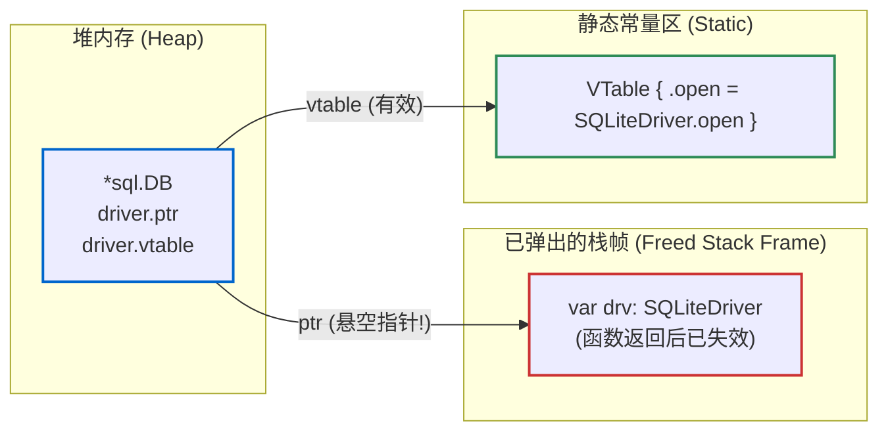

# Zig 中的栈、堆与地址稳定性

**日期**: 2026-11-28

在把 Go 的 `database/sql` 移植到 Zig 时，我们遇到了一个从 Go、Java 或 Rust 转写 Zig 时很常见的问题：

```zig
fn openAppDb(allocator: std.mem.Allocator, io: std.Io) !*sql.DB {
    var drv = sql.sqlite.SQLiteDriver.init(allocator, .{ .foreign_keys = true });
    return sql.DB.open(allocator, io, drv.driver(), "app.db");
}
```

在 Go 里，类似写法完全合法，编译器会自动把 `drv` 逃逸到堆上，由 GC 管到无人引用为止。但在 Zig 里，这段代码能通过编译，却会在函数返回后第一次 `db.ping()` 或 `db.query()` 时触发 Use-After-Free（UAF）。

表面上看像是 VTable 接口的问题，但实际上和 VTable 关系不大。本文结合 `stdgo.database.sql` 和 Zig 0.17.0 标准库源码，先说明悬空指针的成因（栈帧生命周期与地址稳定性），再按放栈还是放堆两种情况梳理常见做法。

---

## 1. 现象与根因：悬空指针与 VTable 关系不大

Zig 没有内置的 `interface` 关键字或 `dyn Trait`，动态多态通常用胖指针（Fat Pointer）手写实现。以 `driver.Driver` 为例：

```zig
pub const Driver = struct {
    ptr: *anyopaque,
    vtable: *const VTable,

    pub const VTable = struct {
        open: *const fn (
            ctx: *anyopaque,
            io: std.Io,
            dsn: []const u8,
            deadline: Deadline,
        ) anyerror!Conn,
    };
};
```

而具体驱动 `SQLiteDriver` 的 `driver()` 与 `open()` 是这样实现的：

```zig
pub const SQLiteDriver = struct {
    allocator: std.mem.Allocator,
    config: Config = .{},

    pub fn driver(self: *SQLiteDriver) driver_pkg.Driver {
        return .{
            .ptr = self, // 直接取调用方传入的 *SQLiteDriver 地址
            .vtable = &.{
                .open = SQLiteDriver.open,
            },
        };
    }

    fn open(
        ctx: *anyopaque,
        io: std.Io,
        dsn: []const u8,
        deadline: Deadline,
    ) anyerror!driver_pkg.Conn {
        // 真正建连时，把擦除掉的 ctx 强转回 *SQLiteDriver，再读取其中的字段
        const self: *SQLiteDriver = @ptrCast(@alignCast(ctx));
        const null_terminated_dsn = try self.allocator.dupeSentinel(u8, dsn, 0);
        // ... 应用 self.config（busy_timeout_ms / foreign_keys / journal_mode 等）
    }
};
```

把 `openAppDb` 和上面这段代码连起来看，执行过程是这样的：
1. `openAppDb` 在自己的栈帧上声明了局部变量 `var drv = SQLiteDriver.init(...)`；
2. `drv.driver()` 把 `.ptr` 设成了 `&drv`（指向当前栈帧），把 `.vtable` 指向编译期常量表（静态只读区，程序全程有效）；
3. `DB.open` 把这个 `Driver` 胖指针按值复制进堆上的 `DB` 结构体，随后 `openAppDb` 返回、栈帧弹出；
4. 之后调用方执行 `db.ping()` 或 `db.query()` 时，`DB` 才会延迟调用保存的 `Driver.open(...)`，在 `SQLiteDriver.open` 里把 `ctx` 转回 `*SQLiteDriver` 并读取 `self.allocator` 和 `self.config`——此时 `ptr` 指向的早已是失效的栈内存：



这件事其实和 VTable 本身关系不大。哪怕不用 VTable、不做类型擦除，直接让 `DB` 存一个普通具体指针 `drv: *SQLiteDriver`，只要把局部栈变量 `&drv` 存进 `DB` 再带出函数，同样会产生悬空指针。

VTable 在这里只是把问题藏得更深了：
1. **藏起了取地址操作 `&`**：如果函数直接要求 `*SQLiteDriver`，调用方写 `&drv` 时通常会警觉“我在传局部变量的地址”；而 `drv.driver()` 返回的是一个看似按值传递的 `driver.Driver` 结构体，表面上看不到 `&`，很容易让人下意识当成可以随便带出作用域的接口值。
2. **容易把接口设计带偏**：面对普通指针 `*SQLiteDriver`，没人会纠结要不要由 `DB.close()` 替它释放；包成 VTable 接口后，却很容易产生“在 `VTable` 里加个 `deinit` 顺手释放”的冲动（第 2.3 节会专门讨论为什么不能这么做）。

跨语言对比一下，差异出在所有权与内存模型上，而不是多态机制：
- **Go / Java**：有 GC 和逃逸分析，编译器发现局部变量被外部引用，会自动把它分配到堆上；
- **Rust**：通过 `&'a T` / `&'a dyn Trait`（借用）和 `Box<T>` / `Box<dyn Trait>`（拥有）把生命周期写进类型系统，上面的 `openAppDb` 过不了借用检查；
- **Zig**：无论是 `*SQLiteDriver` 还是 `ptr: *anyopaque` 都只是裸地址，没有 GC 也没有逃逸分析，对象放栈上还是放堆上完全由调用方决定。

### 1.1 什么时候必须分配堆变量

撇开 VTable 不谈，悬空指针归根结底对应一个问题：这个对象该放栈上，还是放堆上？

Zig 没有逃逸分析，默认都放栈上；除“大小编译期未知”外，只有满足下面两个条件之一，才必须上堆：

1. **活得比当前函数久**：函数返回后，别的对象还要继续用它（栈帧一弹出，栈变量就失效）。
2. **地址不能变**：别的对象保存了指向它的指针，不能再按值拷贝移动（一移动，旧指针就悬空）。

用这两条看 `stdgo.database.sql` 里的几个核心对象，栈和堆的分界非常清楚：

| 对象 | 放栈还是放堆 | 原因 |
| :--- | :--- | :--- |
| `main()` 里的 `var drv` | **栈** | `main()` 活得比 `db` 久，且 `drv` 原地不动 |
| 工厂函数 `openAppDb()` 里的 `drv` | **必须上堆** | 函数返回后 `db` 还要调用它（满足条件 1） |
| `DB` 及其内部状态对象（管理事务、语句、结果集等） | **必须上堆** | 被子连接或双向链表持有多处回指指针，地址必须稳定（满足条件 2） |

`SQLiteDriver` 到底落在表格的第一行还是第二行，库本身并不知道，只有调用方知道。因此库不应该替调用方强行堆分配，而是把“放栈还是放堆”的选择权留给调用方。

---

## 2. 放栈上 vs 放堆上

既然库把选择权留给了调用方，实际写代码时，顺着 1.1 节的两类场景分别处理即可：

### 2.1 放栈上：零堆分配

**做法 A：同作用域 LIFO 声明（最常见）**

在 `main` 或测试函数里，按“先创建驱动，再创建 DB”的顺序声明，`defer` 天然按相反顺序（先关 `db`，再释放栈帧）执行：

```zig
var sqlite_drv = sql.sqlite.SQLiteDriver.init(allocator, .{
    .busy_timeout_ms = 5000,
    .foreign_keys = true,
});
const db = try sql.DB.open(allocator, io, sqlite_drv.driver(), "app.db");
defer db.close();
```

标准库里最常见的对应写法是 [`std.heap.ArenaAllocator`](https://github.com/jiacai2050/zig/blob/0.17.0/lib/std/heap/ArenaAllocator.zig#L46)：在当前栈帧上 `var arena = std.heap.ArenaAllocator.init(gpa); defer arena.deinit();`，再把 `arena.allocator()` 传给下游，只要下游不把接口带出当前作用域，就不需要额外堆分配。

**做法 B：封装结构体 + 原地初始化（`init(self: *Self, ...)`）**

如果想把驱动和 `DB` 封装进同一个结构体（下面命名为 `AppDb`）、又不想多一次堆分配，可以让调用方先在栈上固定地址，再传入指针原地初始化（Zig 惯例直接命名为 `init` 并返回 `void` / `!void`）：

```zig
pub const AppDb = struct {
    drv: sql.sqlite.SQLiteDriver,
    db: *sql.DB,

    pub fn init(
        self: *AppDb,
        allocator: std.mem.Allocator,
        io: std.Io,
        dsn: []const u8,
    ) !void {
        self.drv = sql.sqlite.SQLiteDriver.init(allocator, .{
            .busy_timeout_ms = 5000,
            .foreign_keys = true,
            .journal_mode = .wal,
        });
        self.db = try sql.DB.open(allocator, io, self.drv.driver(), dsn);
    }

    pub fn deinit(self: *AppDb) void {
        self.db.close(); // 必须先关 db，再释放外层 AppDb（含 drv）
    }
};
```

调用方式如下：

```zig
var app: AppDb = undefined;
try app.init(allocator, io, "app.db");
defer app.deinit();
```

只要 `app` 在初始化之后不再按值拷贝移动，它就既满足地址稳定，又保持零堆分配。

这种接收 `*Self` 原地初始化的写法在 Zig 0.17 标准库里同样常见，原因一致：结构体在初始化期间就需要把指向自身的指针存下来。

- **`std.Io.Uring`**（[`lib/std/Io/Uring.zig`](https://github.com/jiacai2050/zig/blob/0.17.0/lib/std/Io/Uring.zig#L811)）：在 `init` 里直接把 `ev.io()`（内含指向 `ev` 自身的接口指针）存进了 `stderr_writer` 字段，和上面 `self.db` 保存 `self.drv.driver()` 是同一种情况：
  ```zig
  pub fn init(ev: *Evented, backing_allocator: Allocator, options: InitOptions) !void {
      // ...
      ev.* = .{
          // ...
          .stderr_writer = .{
              .io = ev.io(), // 自引用：保存指向 ev 自身的接口
              // ...
          },
      };
  }
  ```
- **`std.Io.Kqueue`**（[`lib/std/Io/Kqueue.zig`](https://github.com/jiacai2050/zig/blob/0.17.0/lib/std/Io/Kqueue.zig#L164)）与 **`std.Io.File.MultiReader`**（[`lib/std/Io/File/MultiReader.zig`](https://github.com/jiacai2050/zig/blob/0.17.0/lib/std/Io/File/MultiReader.zig#L57)）：同样分别以 `init(k: *Kqueue, ...) !void` 和 `init(mr: *MultiReader, ...) void` 原地初始化，在函数内部把指向自身或内部字段的指针写入线程上下文与子流结构。

### 2.2 放堆上：跨栈帧返回

当初始化逻辑必须抽成工厂函数、把结果返回给外层时，驱动需要活得比当前函数久。此时应把上面的 `AppDb` 直接分配在堆上。

> [!WARNING]
> **Zig 里最容易踩的二次坑（违背 1.1 节的“地址稳定性”原则）**：
> 如果在工厂函数里构造局部 `var app = AppDb{ .drv = ..., .db = undefined };`，把 `app.drv.driver()`（指向局部变量 `app.drv`）传给 `DB.open`，再按值 `return app;`，返回时 `app` 会被拷贝到调用方的新地址，`app.db` 里存的 `ptr` 依然指向旧栈帧，会立刻悬空。

正确做法是给 `AppDb` 增加 `create` / `destroy`，由 `allocator.create(AppDb)` 直接在堆上分配容器，再复用上面的 `init` 完成初始化，地址从始至终不变（对 `std.Io.Kqueue` / `std.Io.Uring` 也是同样的用法：`allocator.create` 配合 `init`）：

```zig
// 在上面的 AppDb 结构体中补充堆分配的 create / destroy：
pub fn create(allocator: std.mem.Allocator, io: std.Io, dsn: []const u8) !*AppDb {
    const self = try allocator.create(AppDb);
    errdefer allocator.destroy(self);
    try self.init(allocator, io, dsn);
    return self;
}

pub fn destroy(self: *AppDb, allocator: std.mem.Allocator) void {
    self.deinit(); // 先关 db
    allocator.destroy(self); // 再释放包含 drv 的堆内存
}
```

Zig 0.17 标准库里，跨栈帧返回并需要地址稳定的对象常见两种堆分配写法：

- **整个结构体放堆上**：[`std.Build.Step.Run.create`](https://github.com/jiacai2050/zig/blob/0.17.0/lib/std/Build/Step/Run.zig#L215)（以及 `Compile`、`InstallArtifact` 等所有 `Step` 子类）都由 `owner.allocator.create(Run)` 在堆上分配后返回 `*Run`，因为返回的 `Run` 既要活出工厂函数，内部嵌着的 `.step` 又会被构建图以 `*Step` 指针引用（执行时通过 `@fieldParentPtr` 反推回 `*Run`）：
  ```zig
  pub fn create(owner: *std.Build, name: []const u8) *Run {
      const run = owner.allocator.create(Run) catch @panic("OOM");
      run.* = .{
          .step = .init(.{
              .tag = base_tag,
              .name = name,
              .owner = owner,
          }),
          // ...
      };
      return run;
  }
  ```
- **只把被指针引用的成员放堆上**：[`std.json.parseFromTokenSource`](https://github.com/jiacai2050/zig/blob/0.17.0/lib/std/json/static.zig#L103-L120) 返回的 [`std.json.Parsed(T)`](https://github.com/jiacai2050/zig/blob/0.17.0/lib/std/json/static.zig#L57) 虽然本身按值返回，但把 `arena` 存成了堆指针 `arena: *ArenaAllocator`，而不是直接内嵌值类型 `ArenaAllocator`：
  ```zig
  var parsed = Parsed(T){
      .arena = try allocator.create(ArenaAllocator),
      .value = undefined,
  };
  errdefer allocator.destroy(parsed.arena);
  parsed.arena.* = ArenaAllocator.init(allocator);
  errdefer parsed.arena.deinit();

  parsed.value = try parseFromTokenSourceLeaky(T, parsed.arena.allocator(), scanner_or_reader, options);
  return parsed;
  ```
  因为解析过程中把 `parsed.arena.allocator()`（内含指向 `arena` 的指针）交给了 `parsed.value`；把 `arena` 放上堆，按值 `return parsed` 时地址才不会变，调用方最后通过 `parsed.deinit()` 依次调用 `arena.deinit()` 和 `allocator.destroy(arena)` 释放。

### 2.3 为什么不加 `VTable.deinit`

写完 2.2 节的 `AppDb` 后，很容易冒出一个想法：能不能省掉外层 `AppDb`，在 `Driver.VTable` 里加一个可选的 `deinit` 回调，堆分配的驱动填上 `deinit` 让 `DB.close()` 顺手释放，栈上的驱动把 `deinit` 留 `null`？

```zig
pub const VTable = struct {
    open: *const fn (...) anyerror!Conn,
    deinit: ?*const fn (ctx: *anyopaque, allocator: std.mem.Allocator) void = null,
};
```

我们在 `stdgo.database.sql` 里也评估过这个方案，最终放弃了：它在同一个 `driver.Driver` 类型里混进了“借用”和“移交所有权”两种语义。调用方从类型上看不出这个 `Driver` 能不能复用给两个 `DB`（复用移交型会在关闭时 double-free），也容易搞混 `DB.open` 失败时该由谁释放。

因此 `driver.Driver` 最终不设 `VTable.deinit`，固定为纯非拥有视图，与驱动层的 `Conn`、`Stmt`、`Tx`、`Rows` 接口保持统一，所有权完全归调用方。

---

## 3. Zig 0.17 标准库的做法

翻看 [Zig 0.17.0 标准库源码](https://github.com/jiacai2050/zig/tree/0.17.0/lib/std)会发现，无论接口形态怎么演进，“接口本身只借用、不负责释放底层实现”是共同约定。标准库里共有三种典型写法：

### 3.1 `std.mem.Allocator`

源码：[`lib/std/mem/Allocator.zig`](https://github.com/jiacai2050/zig/blob/0.17.0/lib/std/mem/Allocator.zig#L22)

```zig
/// Any comparison of this field may result in illegal behavior, since it may
/// be set to `undefined` in cases where the allocator implementation does not
/// have any associated state.
ptr: *anyopaque,
vtable: *const VTable,
```

- 有状态实现（`SafeAllocator`、`ArenaAllocator`）由调用方在外部声明并 `defer arena.deinit()`；
- 无状态实现（`page_allocator`、`c_allocator`）把 `ptr` 填为 `undefined`；
- `Allocator.VTable` 里只有 `alloc`/`resize`/`remap`/`free`，没有 `deinit`。

### 3.2 `std.Io`

源码：[`lib/std/Io.zig`](https://github.com/jiacai2050/zig/blob/0.17.0/lib/std/Io.zig#L25)

```zig
userdata: ?*anyopaque,
vtable: *const VTable,
```

- 用 `?*anyopaque` 取代了 `Allocator` 里的 `undefined`，对无状态实现更安全明确；
- 同样没有 `deinit`：[`std.Io.Threaded`](https://github.com/jiacai2050/zig/blob/0.17.0/lib/std/Io/Threaded.zig) / [`Uring`](https://github.com/jiacai2050/zig/blob/0.17.0/lib/std/Io/Uring.zig) / [`Kqueue`](https://github.com/jiacai2050/zig/blob/0.17.0/lib/std/Io/Kqueue.zig) 的生命周期完全归外层调用方管理（如第 2.1 节所示，调用方在外部 `var kq: std.Io.Kqueue = undefined; try kq.init(gpa, .{}); defer kq.deinit();`，再把 `kq.io()` 传给下游）。

### 3.3 `std.Io.Reader` / `std.Io.Writer`

源码：[`lib/std/Io/Reader.zig`](https://github.com/jiacai2050/zig/blob/0.17.0/lib/std/Io/Reader.zig#L16) / [`lib/std/Io/Writer.zig`](https://github.com/jiacai2050/zig/blob/0.17.0/lib/std/Io/Writer.zig)

```zig
vtable: *const VTable,
buffer: []u8,
seek: usize,
end: usize,
```

这是 Zig 0.15 起引入的侵入式接口（Intrusive Interface）：去掉 `ptr` 字段，把 `interface: std.Io.Reader` 直接嵌在具体实现结构体里，vtable 回调中用 `@fieldParentPtr("interface", r)` 根据字段偏移反推出外层结构体指针：

```zig
const MyReader = struct {
    // ... 具体实现状态
    interface: std.Io.Reader,

    fn stream(r: *std.Io.Reader, w: *std.Io.Writer, limit: std.Io.Limit) !usize {
        const self: *MyReader = @fieldParentPtr("interface", r);
        _ = self;
        // ...
    }
};
```

它同样是非拥有的：外层结构体（如上面的 `MyReader` 或标准库里的 [`std.Io.File.Reader`](https://github.com/jiacai2050/zig/blob/0.17.0/lib/std/Io/File/Reader.zig)）活在调用方作用域里，接口指针 `&my_reader.interface` 的寿命受限于外层结构体，且同样要求外层结构体地址稳定。

---

## 4. 延伸原则与选型清单

- **同时提供“借用”与“跨作用域持有”时，拆成两个类型**：像标准库的 [`std.json.Parsed(T)`](https://github.com/jiacai2050/zig/blob/0.17.0/lib/std/json/static.zig#L57) 或我们给 `Row` / `Rows` 设计的 `sql.Owned(T)` 那样，用返回类型明确区分生命周期，而不是塞进同一个接口的可选 `deinit`：
  ```zig
  const UserSummary = struct { name: []const u8, balance: f64 };

  // 借用版：零分配，name 切片仅在 row.close() 前有效
  var row = db.queryRow("SELECT name, balance FROM users WHERE id = ?", .{1}, .none);
  defer row.close();
  const borrowed = try row.scanStruct(UserSummary, .none);

  // 拥有版：返回独立的 Owned(UserSummary) 包装体，深拷贝切片，由 owned.deinit() 释放
  var row2 = db.queryRow("SELECT name, balance FROM users WHERE id = ?", .{1}, .none);
  const owned = try row2.scanStructOwned(allocator, UserSummary, .none);
  defer owned.deinit();
  ```
- **不需要运行时多态时，直接用 `comptime` 泛型**：编译期实现已固定时，把具体类型作为泛型参数传入即可，既无间接调用开销，也没有类型擦除带来的生命周期问题。

| 场景 | 推荐做法 | 避坑要点 |
| :--- | :--- | :--- |
| 同作用域使用、原地不动 | 放栈上（LIFO 声明或原地 `init(self: *Self, ...)`），零堆分配 | 先关闭使用者，再退出声明作用域 |
| 工厂函数跨栈帧返回 | `allocator.create` 堆分配组合结构体 + 原地 `init` | 不要在按值返回的函数里建好指向局部变量的指针后再 `return` |
| 同时需要零拷贝借用与跨作用域持有 | 用独立类型区分（如 `T` vs `Owned(T)`） | 避免在同一个接口里用可选 `deinit` 混用借用与拥有 |
| 编译期实现固定 | 直接用 `comptime` 泛型 | 不为不需要的动态多态付出类型擦除代价 |
